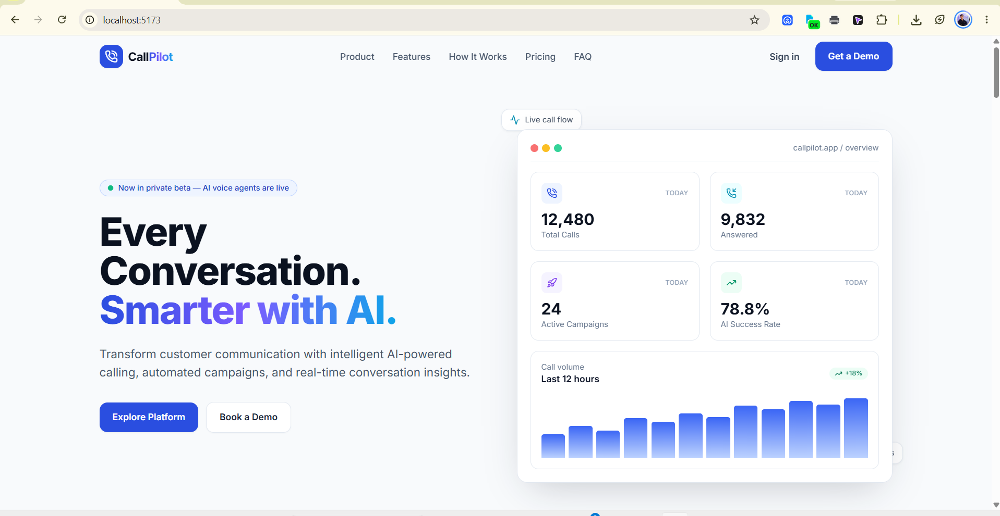
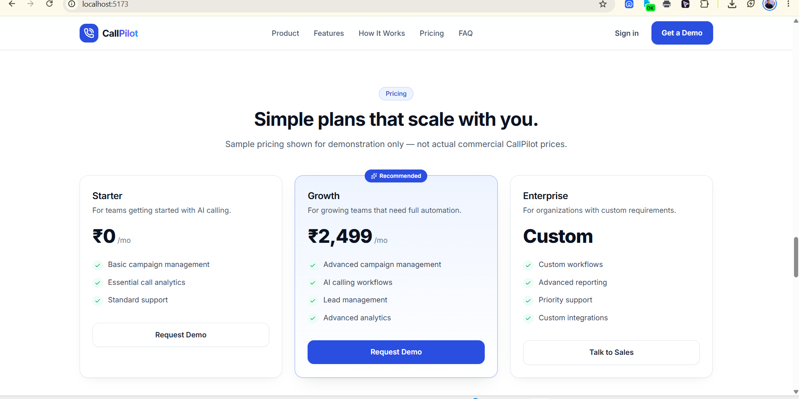
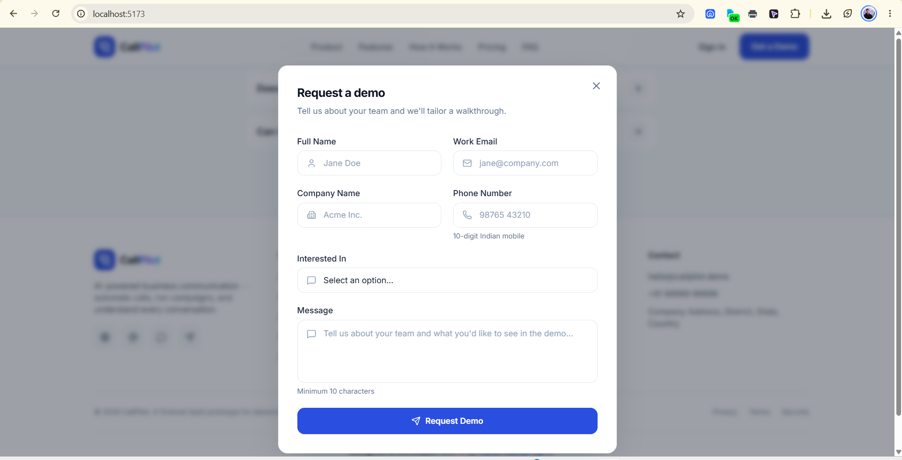

# CallPilot – AI-Powered Business Communication Platform

CallPilot is a modern SaaS landing page concept for AI-powered business communication.

## Live Demo
https://callpilotapp.netlify.app/

## Features
- Modern and responsive UI
- Interactive navigation
- AI business communication concept
- Feature showcase
- Pricing section
- Demo request interface
- FAQ section

## Technologies
- React.js
- JavaScript
- HTML5
- CSS3
- Vite
- Tailwind CSS

## Installation

```bash
npm install
npm run dev
```


## 📸 Project Screenshots on Desktop

### Homepage – Desktop


### Homepage – Additional View


### Hero Section


### Pricing Section


### Demo Request Form



## Developer
Harsh Kumar Rai

GitHub: https://github.com/Harshrai4211
Portfolio: https://harshkumarrai.netlify.app


